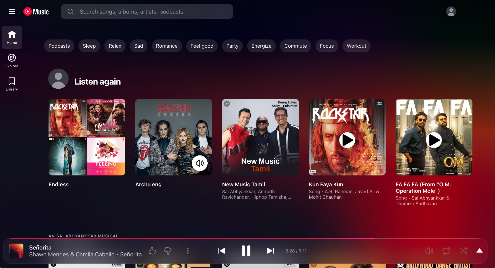
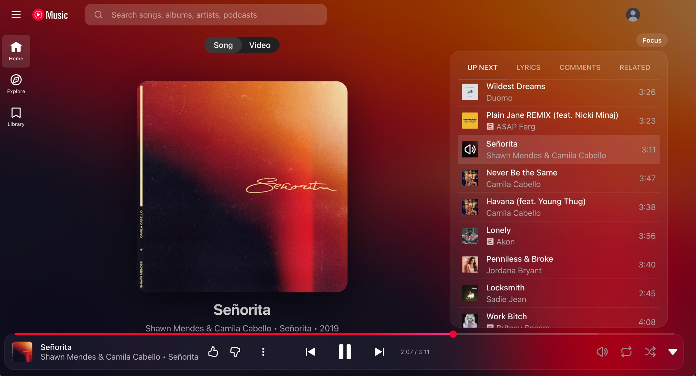

# YTM Restyle

A browser extension that gives [YouTube Music](https://music.youtube.com) a
new look. It changes only how the page looks in your browser. It has no build
step and no dependencies.

## Features

- **Ambient mode.** The album art or the video shows as a soft color field
  behind the page.
- **Floating panels.** The sidebar, the queue, and the player bar are rounded
  glass panels.
- **Now-playing page.** Large artwork in the center, with the title and the
  artist below it. A "Focus" button gives the queue or the lyrics the full
  page.
- **Home page.** Large cards, song tiles, and mood chips that stay in view
  during a scroll.
- **Player bar.** The track is on the left and the transport controls are in
  the center.
- **Declutter.** Promo banners and other noise are hidden.

## Install

The extension is not in a browser store. Load it from the source:

1. Download or clone this repository.
2. Open `chrome://extensions` in Chrome, Edge, or Brave.
3. Turn on "Developer mode".
4. Click "Load unpacked" and select the repository folder.
5. Open or reload `music.youtube.com`.

### Or build it with a coding agent

If you do not want to clone the repository, give [PROMPT.md](PROMPT.md) to
your coding agent. The agent builds the extension from zero.

## Settings

Click the extension icon to open the settings. Each change applies
immediately.

- A switch for each feature group.
- Sliders for the ambient strength, the ambient blur, and the artwork corners.
- "Hide shelves": words with commas between them. A home page shelf is hidden
  when its title contains one of the words.

## How it works

| File | Function |
| --- | --- |
| `manifest.json` | Loads the styles and the script on `music.youtube.com`. |
| `style.css` | All styles. Each feature group is one block that a class on `<html>` turns off. |
| `content.js` | Applies the settings, paints the ambient canvas, and adds the title block and the "Focus" button. |
| `popup.html`, `popup.js` | The settings popup. Settings are in `chrome.storage.local`. |

## Limits

- YouTube Music can change its page structure at any time. A style can then
  stop working. Turn off the related switch until the style is repaired.
- The styles are for the dark desktop layout in Chromium browsers. Firefox
  and Safari are not tested.
- The extension reads no account data and sends no data to a server.

## Contributing

Issues and pull requests are welcome. Keep a change small, and say which page
you tested it on.

## Credits

The idea for ambient mode comes from
[YouTube Ambilight](https://github.com/WesselKroos/youtube-ambilight) by
Wessel Kroos. This project shares no code with it.

## License

[MIT](LICENSE)

This project is not affiliated with Google or YouTube. YouTube Music is a
trademark of Google LLC.
